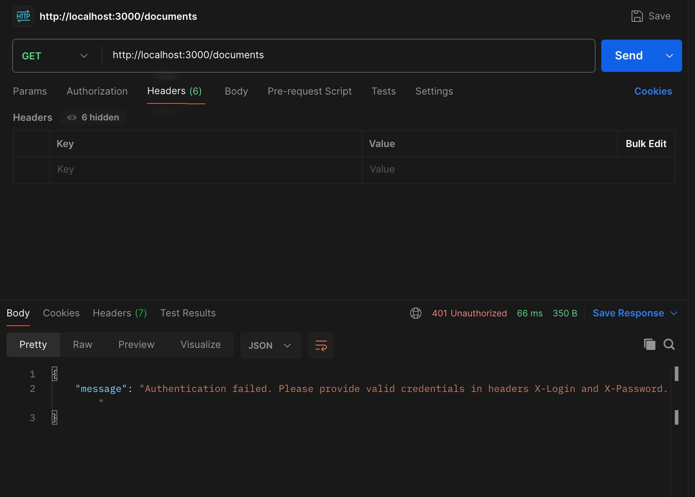
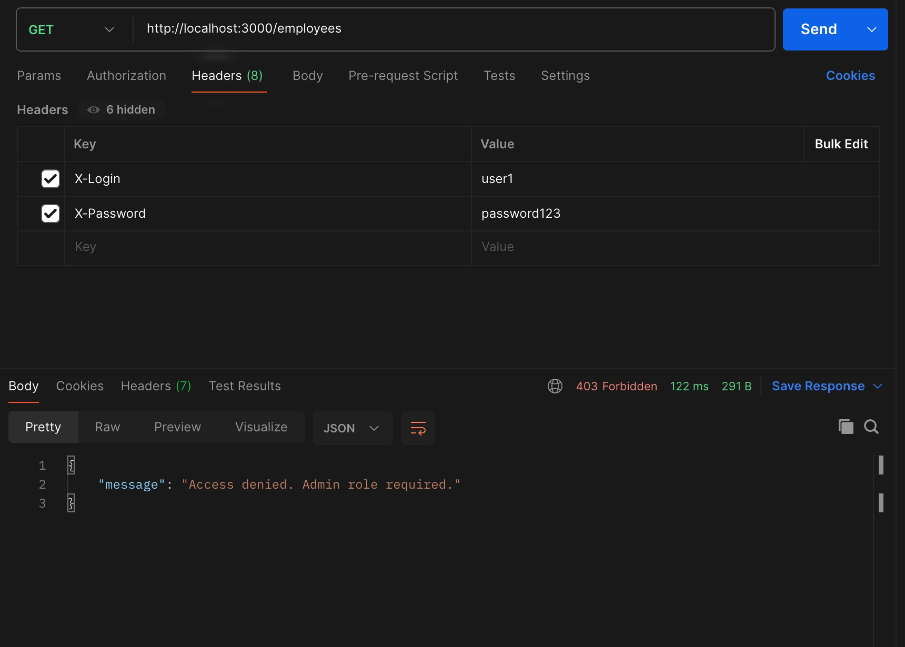
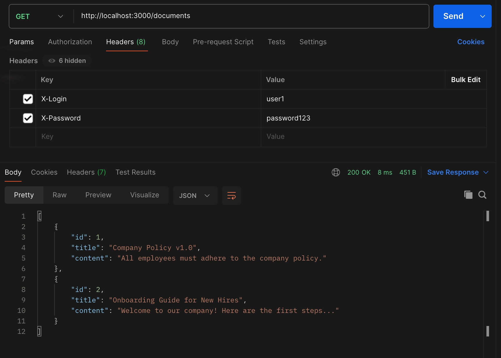
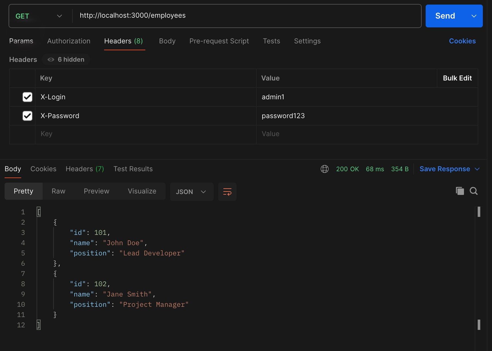
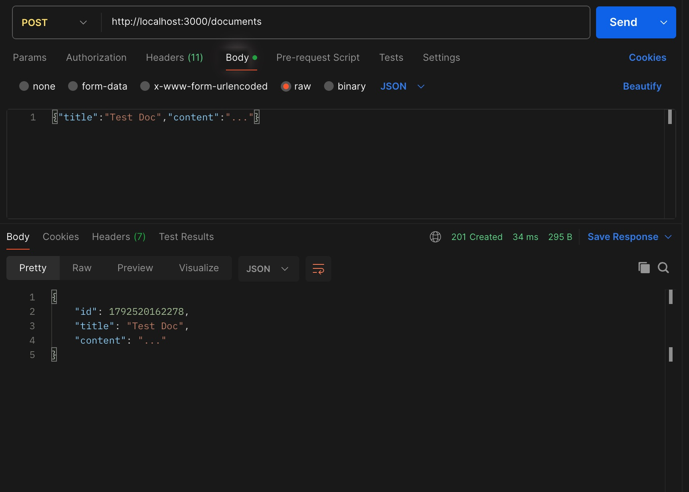
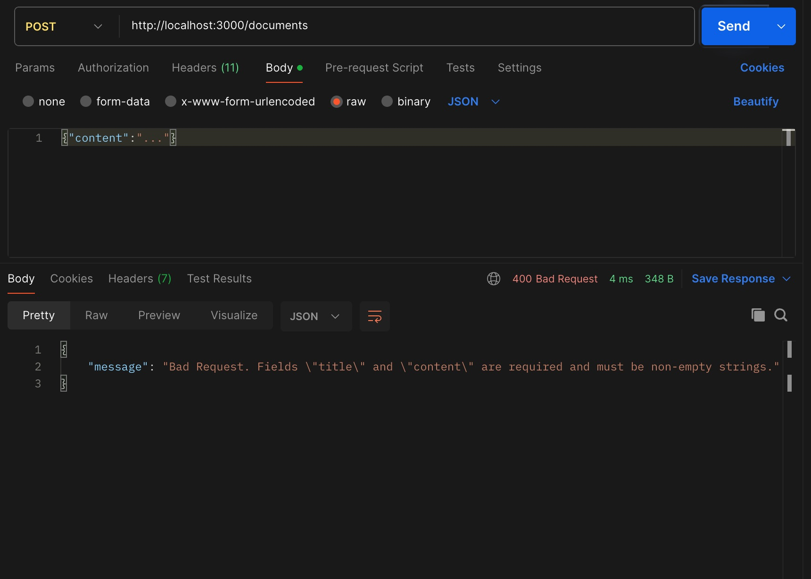
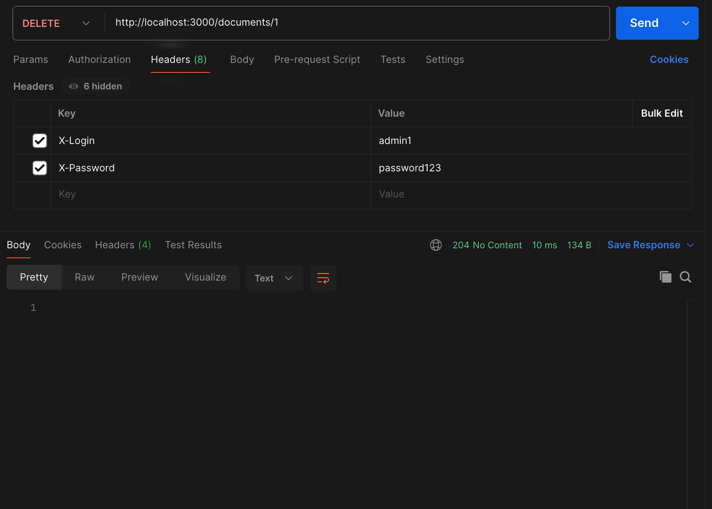
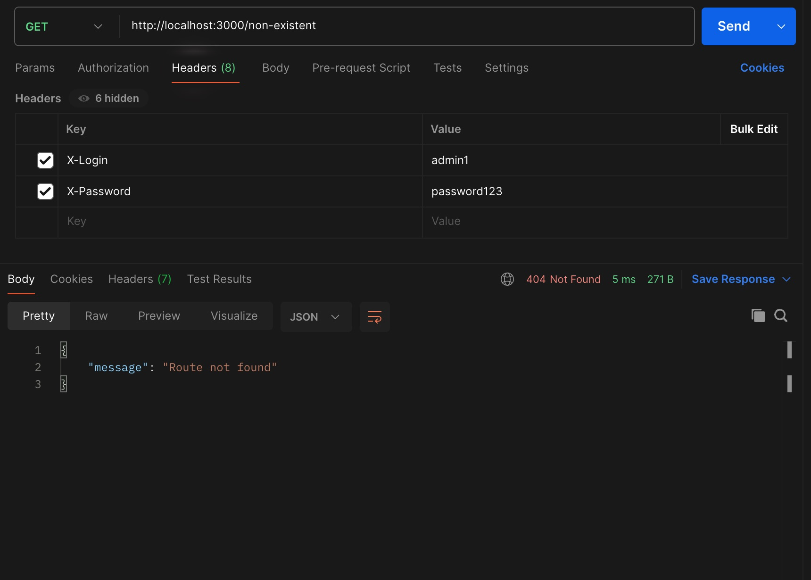
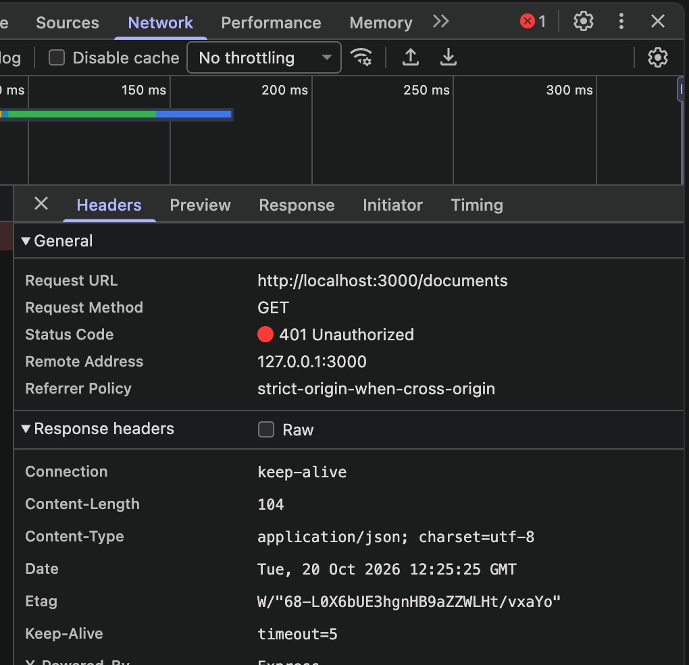

# Перевірка API в Postman

На скріншотах видно запит, його параметри та відповідь сервера. Запити виконані на `http://localhost:3000`.

## Без заголовків — 401

## Доступ користувача до /employees — 403

## Список документів — 200

## Список співробітників — 200

## Створення документа — 201

## Запит без title — 400

## Видалення документа — 204

## Невідомий маршрут — 404

## Перевірка 401 у браузері

У вкладці Network видно статус відповіді на `GET /documents` без заголовків авторизації.

